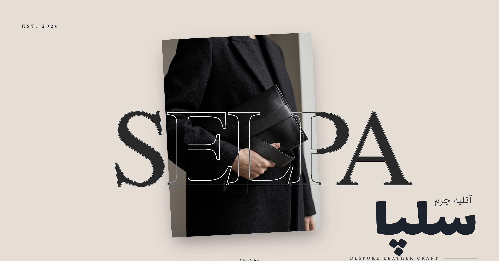
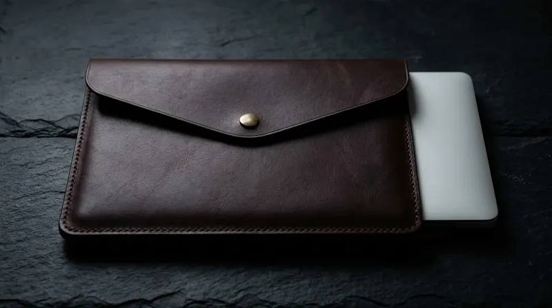
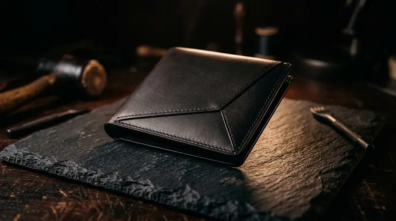

<div align="center">

<sub>INDEPENDENT ATELIER · EST. 2026 · MASHHAD</sub>

# S E L P A

### Leather, shaped by hand. Stories, carried every day.

<p dir="rtl">سلپا — روایتی از چرم، دست و همراهی.</p>

<a href="https://selpa.vercel.app/">
  
</a>

**[Explore the live experience ↗](https://selpa.vercel.app/)**

[Selected works](https://selpa.vercel.app/#selected-works) &nbsp; / &nbsp; [The archive](https://selpa.vercel.app/#archive) &nbsp; / &nbsp; [Visit & commission](https://selpa.vercel.app/#contact-section)

`ASTRO` &nbsp; `REACT` &nbsp; `TYPESCRIPT` &nbsp; `TAILWIND CSS` &nbsp; `GSAP`

</div>

---

## 01 / The atelier

A portfolio for a bespoke leather atelier, built around the details that make each piece personal: the grain, the stitch and the way it lives with its owner. Warm neutrals, dark surfaces and Persian typography carry that same care into the digital experience.

The site brings together selected products, a visual journey through the craft, a seven-piece archive and a direct path to a custom order.

## 02 / Objects & details

<table>
  <tr>
    <td width="33%" align="center">
      <a href="https://selpa.vercel.app/#selected-works">
        
      </a>
      <br />
      <sub>01 — TRAVEL JOURNAL</sub>
      <p><strong>A place for the journey.</strong></p>
    </td>
    <td width="33%" align="center">
      <a href="https://selpa.vercel.app/#selected-works">
        
      </a>
      <br />
      <sub>02 — LAPTOP FOLIO</sub>
      <p><strong>Only the essentials.</strong></p>
    </td>
    <td width="33%" align="center">
      <a href="https://selpa.vercel.app/#selected-works">
        
      </a>
      <br />
      <sub>03 — MINIMAL WALLET</sub>
      <p><strong>Made to stay close.</strong></p>
    </td>
  </tr>
</table>

## 03 / The digital experience

| Detail | Experience |
| :--- | :--- |
| **Editorial opening** | Large layered typography, a focused product photograph and a Persian brand signature. |
| **Selected works** | Product stories with a direct link to discuss a bespoke order. |
| **The making** | A horizontal scroll sequence on desktop; a vertical gallery on smaller screens. |
| **The archive** | Seven pieces in a responsive grid, with visible captions and space around each image. |
| **A hidden layer** | On desktop, scroll upward at the top of the page to discover Whispers and an alternate hero state. |
| **Considered motion** | Parallax on larger screens, static mobile layouts and support for reduced-motion preferences. |

### Less weight. More room to breathe.

Homepage photographs use **WebP variants at 480, 800 and 1280 pixels**, selected for the available screen width. Below-the-fold images load lazily; the hero image loads eagerly. Intrinsic image dimensions reserve space while photographs load.

The 800-pixel variants of the 13 homepage photographs total approximately **815 KB**, compared with **10.4 MB** for the originals. The originals remain available in the repository.

## 04 / Under the surface

| Layer | Tools |
| :--- | :--- |
| Rendering & UI | Astro · React · TypeScript |
| Styling & type | Tailwind CSS · locally hosted Persian fonts |
| Motion | GSAP · ScrollTrigger |
| Whispers | Astro DB · server API routes |
| Images | Sharp · responsive WebP assets |
| Deployment | Vercel · `@astrojs/vercel` |

<details>
<summary><strong>Open the workbench — local development</strong></summary>

### Requirements

Use **Node.js 22.12.0 or newer** and npm.

```bash
npm install
npm exec astro dev -- --background
```

Open the local URL printed by Astro, normally [localhost:4321](http://localhost:4321).

Manage the background server:

```bash
npm exec astro dev -- status
npm exec astro dev -- logs
npm exec astro dev -- stop
```

### Production build

```bash
npm run build
```

The build script uses `astro build --remote`. Configure your remote Astro DB connection with `ASTRO_DB_REMOTE_URL` and `ASTRO_DB_APP_TOKEN` in your local environment or Vercel project settings. Keep credentials out of Git.

### Updating photographs

Replace the relevant originals in `public/images`, then regenerate the responsive assets:

```bash
npm run images:optimize
```

Commit the generated files in `public/images/optimized` and `src/data/images.json` alongside the originals. The homepage source list is maintained in `scripts/optimize-images.mjs`; add new photographs there before using them with `ResponsiveImage`.

### Project map

```text
src/
├── components/       Product stories, galleries, motion and Whispers
├── data/images.json  Generated image dimensions and responsive variants
├── layouts/          Shared document layout
├── pages/            Astro pages and server API routes
└── styles/           Global styles and responsive layouts
public/
├── fonts/            Persian typefaces
└── images/           Original photographs, optimized assets and previews
scripts/              Image optimization workflow
db/                   Whisper schema and local seed data
```

</details>

---

<div align="center">

<sub>DESIGNED AROUND THE CRAFT.</sub>

**[Step into Selpa ↗](https://selpa.vercel.app/)**

<p dir="rtl">برای دیدن آثار و شروع یک سفارش شخصی، به آتلیه سر بزنید.</p>

</div>
